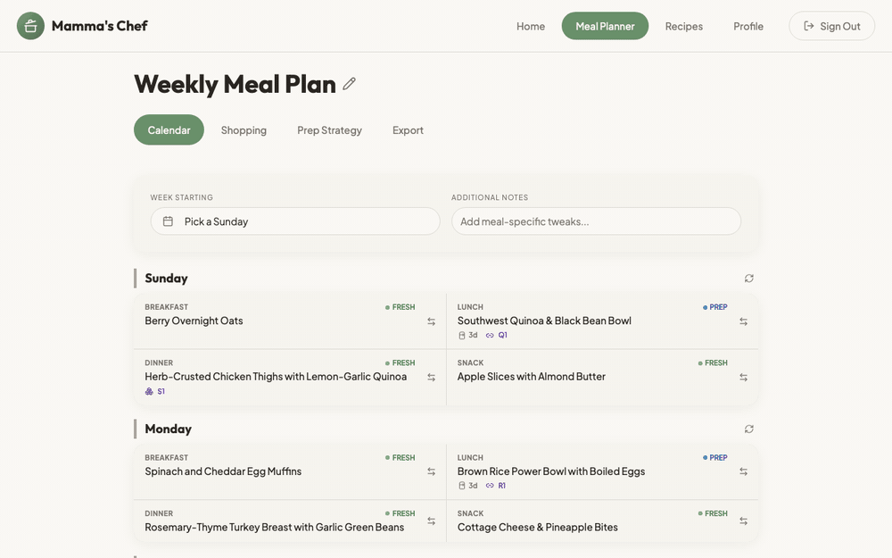
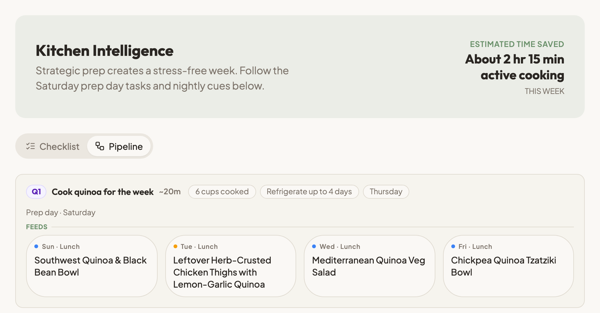

# Mamma's Chef

A self-hosted AI meal planner for busy families with little ones, made by two working parents. It creates a week of well-seasoned meals, a shopping list you can actually shop from, and a prep plan where food carries forward through the week: Monday's dinner becomes Tuesday's lunch. There are options for allergies, toddlers and glucose-conscious eating.

You bring your own AI key, and your database stays on your machine. Website: [mammaschef.ai](https://mammaschef.ai)



## Cook once, eat twice

Most meal planners treat every meal on its own. Mamma's Chef plans how cooked food and prepped ingredients are reused across the week:

- **Planned leftovers.** A meal can make extra on purpose. Monday's roast chicken makes shredded chicken for Tuesday's grain bowls and Wednesday's quesadillas.
- **Prep-day batches.** An hour of prep on your prep day, such as a pot of rice or a tray of roasted vegetables, covers meals later in the week.
- **Storage and use-by dates.** Every batch says how much it makes, how to store it and when to use it by.
- **The Pipeline view.** In the Prep Strategy tab, each batch is shown from the meal that makes it to every meal that uses it, along with an estimate of the cooking time you save.
- **Connected swaps.** Swap or regenerate the meal that makes a batch, and the meals that ate its leftovers switch to the new meal's leftovers.



> **Not medical advice.** Meal plans are written by AI, which makes mistakes. If you or someone you cook for has a food allergy, always check every ingredient and label yourself. See [Allergy safety](#allergy-safety).

## A look inside

### Weekly meal plan


### Shopping list


### Recipe


## What you need

- [Node.js](https://nodejs.org) 20 or newer
- [Docker Desktop](https://www.docker.com/products/docker-desktop/), running
- An API key from an AI provider (you pay that provider for what you use)

## Install

```sh
git clone https://github.com/PreillySMP/mammas-chef.git
cd mammas-chef
npm run setup
```

The first run downloads the database containers and can take several minutes.

## Add your AI key

Open `supabase/functions/.env` and fill in one option:

| Option | Settings |
|---|---|
| **Cerebras** (what the app was built and tuned on) | `CEREBRAS_API_KEY`, `CEREBRAS_REASONING_EFFORT=medium` |
| **OpenAI** | `AI_API_KEY`, `AI_MODEL=gpt-4.1-mini` |
| **Another OpenAI-compatible service** | `AI_BASE_URL`, `AI_API_KEY`, `AI_MODEL` |

Only Cerebras has been tested end to end. The other options use the same request format but haven't generated a full plan yet, and results may be weaker because the prompts were tuned on Cerebras. A model has to return long, well-formed JSON to work here, and small local models often can't.

## Run it

```sh
npm start
```

Open <http://localhost:8080> and create an account. The account only exists on your computer, and no confirmation email is sent.

To stop the app, press `Ctrl+C`, then run `npx supabase stop` to shut down the database. Your data is kept for next time.

## Use it from the terminal or your AI agent

The `mammaschef` command does the same planning without the website, so you, or an AI agent you already use, can plan meals from a chat. It uses the same database, account and AI key as the website, and plans you make show up in both.

### Set it up once

From the `mammas-chef` folder, after [Install](#install) and [Add your AI key](#add-your-ai-key):

```sh
npm link                    # puts `mammaschef` on your PATH
mammaschef start            # starts the database and AI functions (no website)
mammaschef init             # signs in or creates your account; asks for a password
mammaschef profile set --household 3 --allergies sesame --toddler yes
mammaschef doctor           # checks everything and says how to fix problems
```

Run `init` yourself in a terminal, not through an agent. It keeps you signed in through a file in `~/.config/mammaschef/` that only your user can read. `mammaschef stop` shuts everything down.

### Plan from the terminal

```sh
mammaschef plan "plan next week, quick dinners, we have rice and spinach"
mammaschef show latest
mammaschef swap latest tuesday dinner "something faster"
mammaschef regen latest thursday
mammaschef shopping latest
```

`mammaschef help` lists every command. Every command takes `--json` for scripts and agents. Changes save right away; there's no separate Save step. Writing a plan takes about a minute.

### Connect your AI agent

`mammaschef mcp` runs a local [MCP](https://modelcontextprotocol.io) server that agents connect to. Most agents that support local (stdio) MCP servers take a config like this:

```json
{ "mcpServers": { "mammaschef": { "command": "mammaschef", "args": ["mcp"] } } }
```

If your agent can't find the command, use the full path instead, for example `/path/to/mammas-chef/bin/mammaschef`.

For **Claude Code**:

```sh
claude mcp add mammaschef -- mammaschef mcp
```

Then ask things like "plan next week for two adults and a toddler" or "what do I need to buy?". The agent can read and change your profile, create and edit plans, read shopping lists, search recipes, and list and save favorites. Before it writes a week it asks what the website's planner asks: what you have on hand, which meals and days, and whether to build the week around any of your favorites or library recipes. It won't write a second plan for a week that already has one unless you confirm. Its tools can add an allergy but can't remove one; do that yourself with `mammaschef profile set --allergies ...` in a terminal or on the website. An agent that can run terminal commands could still run that command, so check your allergy list if an agent has been reading pages you don't trust. It can't delete plans either; only `mammaschef delete <plan> --yes` in a terminal can.

**What's been tested:** Claude Code (with Claude Opus 5.5 and Claude Haiku 5.5 as the agent's model) and Cerebras as the planning AI. Other agents, including OpenClaw and Hermes, haven't been tested yet. Agents that can run terminal commands can also call `mammaschef ... --json` directly.

**The Grok app isn't supported.** grok.com connectors have to reach your server over a public URL, and this setup isn't built to be exposed to the internet.

**Allergy warnings in chat:** every plan result carries the app's allergy warnings and the "check every label" notice, and the agent is told to pass them on word for word. In testing, the agents did. Your agent writes its own replies, though, so this can't be guaranteed. Open the plan in the website or run `mammaschef show latest` if you want to see the warnings yourself.

## Allergy safety

The app guards against allergens in three ways: it tells the AI which foods to avoid, it scans each plan for matching ingredient keywords, and it can ask for a second opinion from another AI model. Recipes you add from the recipe library get the keyword scan too.

**The AI does still suggest foods you asked to avoid.** In testing, a plan for someone with a sesame allergy included hummus. When a scan finds a likely allergen and a retry doesn't clear it, the plan is still shown: the meal gets a red shield with a warning, and a message lists the affected meals. Swap those meals or check their ingredients.

**The second-opinion check needs a [Vercel AI Gateway](https://vercel.com/ai-gateway) key** (`AI_GATEWAY_API_KEY`). Without one, it is skipped and only the first two remain. The keyword scan only knows the words on its list, so a meal with no warning can still contain an allergen. Never rely on these checks alone.

## Good to know

- **Privacy:** the app doesn't report back to anyone. Meal requests and your preferences, including allergies, go to the AI provider you choose. If you connect an AI agent, everything it reads, including your plans, household details and allergies, also goes to that agent's provider. Web fonts load from Google. Error reporting is off unless you set your own `VITE_SENTRY_DSN`.
- **Daily limits:** each account can generate 10 plans and swap 20 meals a day (regenerating a day counts as a swap), plus 60 AI shopping lists and 60 nutrition estimates, which helps protect your AI bill and stops a looping agent from running it up. A plan or swap that fails doesn't use one up, but failed tries are capped too, at 30 plan runs and 60 swap runs a day. Change them in `supabase/functions/_shared/rateLimit.ts`.
- **Keep it on your computer:** this setup is meant for personal use and isn't hardened for the public internet. By default the local database (Supabase) listens on all network interfaces, not just your computer, and it uses Supabase's well-known default password and keys, so other devices on the same Wi-Fi can reach it. `mammaschef doctor` reminds you when this is the case. Docker Desktop can only limit these ports to your computer on a Business plan, so either run the app only on a network you trust (and `mammaschef stop` elsewhere), or block incoming connections to Docker in your firewall. Turning a firewall on is not enough by itself: Docker usually has to be blocked by name. To test, open `http://<your computer's network address>:54323` on a phone on the same Wi-Fi; it should not load.
- **Hosted Supabase:** if you point the app at a hosted Supabase project instead, turn off new sign-ups in the Supabase dashboard after creating your own account, because every account that signs up can spend your AI key. Don't push this repo's `supabase/config.toml` to a hosted project; it turns email confirmation off.
- **Port conflict:** if `npm run setup` says a port is in use, another Supabase project is probably running. Stop it with `npx supabase stop --project-id <its id>`.

## Development

```sh
npm test                                                        # frontend tests
deno test --allow-env --allow-net --allow-read supabase/functions/_shared  # AI function tests
npm run lint
```

Built with React, Vite, Tailwind and Supabase. Database changes live in `supabase/migrations`, and the AI functions in `supabase/functions`.

## Contributing

Contributions are welcome. Please read [CONTRIBUTING.md](CONTRIBUTING.md) and the [Code of Conduct](CODE_OF_CONDUCT.md) first, and report security problems as described in [SECURITY.md](SECURITY.md). Issues labelled `good first issue` are a friendly place to start.

## Support

This is a small project maintained by one person in their spare time. Contributions are welcome, and replies to issues and pull requests may take a few days.

## License

[MIT](LICENSE)
